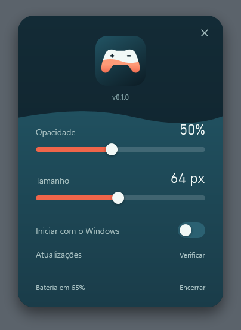

<p align="center">
  
</p>

<h1 align="center">PadTide</h1>

<p align="center">
  A bateria do seu GameSir Nova 2 Lite, sempre à vista no Windows.
</p>

<p align="center">
  <a href="https://github.com/luingry/padtide/releases/latest"><strong>Baixar a versão mais recente</strong></a>
</p>

<p align="center">
  
</p>

## O que ele faz

Ligou o controle, o percentual aparece em um pequeno widget na tela e na área de notificação. Desligou, tudo some sozinho. Você não precisa abrir nem configurar nada.

- **Bateria em tempo real:** o percentual é atualizado a cada 5 segundos.
- **Aviso de bateria baixa:** abaixo de 15%, o contorno do widget fica amarelo.
- **Discreto:** por padrão, o widget fica com 50% de opacidade. Você escolhe a opacidade e o tamanho, de 30 a 100 px.
- **Leve:** um único programa pequeno. Com o controle desligado, ele fica parado até o Windows avisar que o controle voltou.
- **Sempre atualizado:** quando sai uma versão nova, ele pergunta e se atualiza sozinho.

## Como instalar

1. Baixe o `PadTide-Setup-x.y.z.exe` na [página de versões](https://github.com/luingry/padtide/releases/latest).
2. Abra o arquivo. A instalação leva poucos segundos e não pede senha de administrador.
3. Ligue o controle. O widget aparece no canto inferior direito da tela.

O instalador ainda não tem assinatura digital, então o Windows pode mostrar um aviso do SmartScreen. Nesse caso, clique em **Mais informações** e depois em **Executar assim mesmo**.

Você não precisa do GameSir Connect instalado.

## Como usar

| Para... | Faça isto |
|---|---|
| Mudar o widget de lugar | Arraste o widget |
| Abrir as configurações | Clique duas vezes no widget ou clique no ícone da área de notificação |
| Iniciar junto com o Windows | Ative **Iniciar com o Windows** nas configurações |
| Procurar uma versão nova | Clique em **Verificar** nas configurações |
| Fechar o programa | Clique com o botão direito no ícone da área de notificação e escolha **Encerrar** |

<p align="center">
  
</p>

A água ao fundo das configurações sobe até o nível real da bateria.

## Perguntas frequentes

**O ícone não aparece na barra de tarefas. E agora?**
O Windows esconde ícones novos na setinha `^` ao lado do relógio. Arraste o ícone do PadTide para a barra ou ative-o em **Configurações do Windows > Personalização > Barra de tarefas > Outros ícones da bandeja do sistema**.

**Como abro as configurações com o controle desligado?**
Abra o PadTide de novo pelo menu Iniciar.

**O percentual parece ter mudado de repente. É normal?**
O PadTide mostra o número que o próprio controle informa, e esse valor pode oscilar.

## O que é compatível

- Windows 10 ou 11.
- GameSir Nova 2 Lite conectado pelo **dongle 2.4G**.

Por enquanto, as conexões por cabo e por Bluetooth não mostram a bateria. O PadTide é um projeto independente, sem vínculo com a GameSir.

## Para desenvolvedores

```powershell
./scripts/build.ps1
```

O projeto é em C#/WPF sobre .NET Framework 4.8, que já vem no Windows. As regras de versão e de lançamento estão em [AGENTS.md](AGENTS.md) e o histórico em [CHANGELOG.md](CHANGELOG.md).

## Licença

[MIT](LICENSE)
